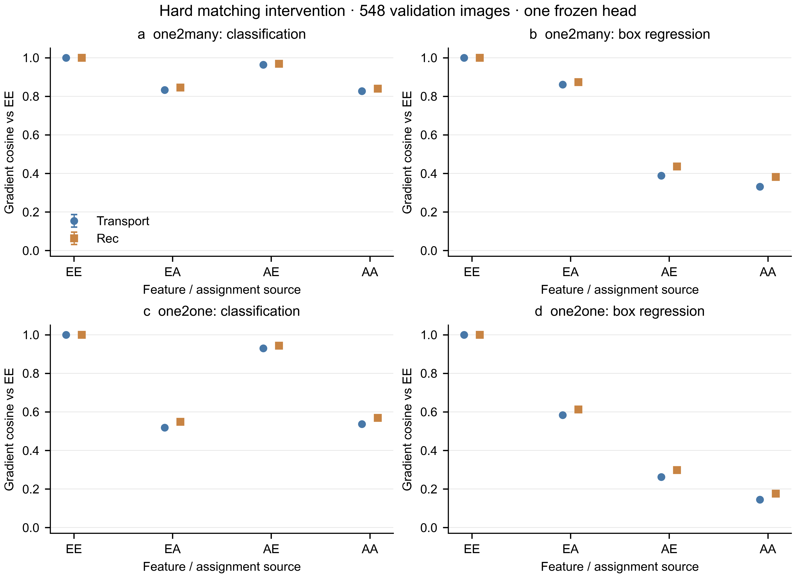
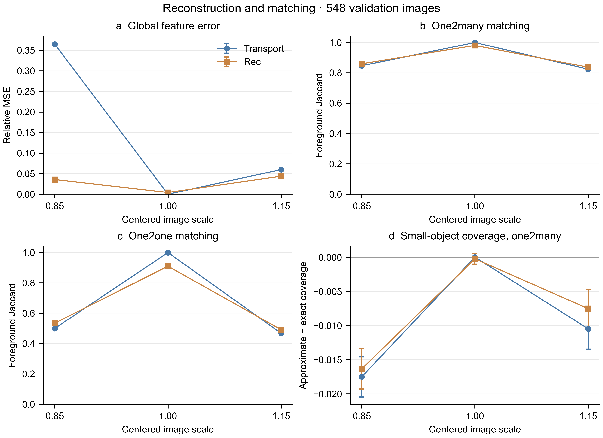

# 2026-10-15：特征近似与标签分配的交叉干预结果

昨天的计算已经完成。核心结果是：既有重建校正器显著降低了全局特征误差，
但对框回归输出梯度的恢复仍然有限；替换监督匹配主要改善分类梯度一致性，
并没有消除定位梯度的偏差。这个结果支持继续区分重建、匹配和定位三个问题，
但还没有验证新的训练方法或 AP 收益。

## 实际完成的规模与完整性

| 阶段 | 图像 | 真实骨干查询 | 干预单元 |
|---|---:|---:|---:|
| 冒烟检查 | 2 张训练图 | 12 | 384 |
| 机制探索 | 固定 128 张训练图 | 768 | 24,576 |
| 验证集复核 | 全部 548 张既有验证图 | 3,288 | 105,216 |

全部使用同一个 Online100 seed-0、epoch-100 的冻结检测头，图像与标签成对。
检测头和校正器状态未变，零训练更新。所有图像的原生/诊断损失最大绝对差值为 0。
验证集缓存身份最大相对 L2 为 0.000136564。逐图 CSV、清单和摘要哈希均通过校验。
这是完整验证集上的机制诊断，不是重新进行的官方 AP 测试。

归档曾因标准 CSV 的 CRLF 换行被 Git 识别为行末空白而停止。
已经修复为仅在该检查中接受 CRLF，保留原文件字节及 SHA256；没有重写指标。
三阶段归档提交分别为 `0b04440`、`d65a3e7`、`aaa2db5`。

## 四格干预说明

E 表示真实特征，A 表示近似特征；首字母决定模型预测的特征来源，第二个字母
决定监督分配的来源。因此 AE 是“近似特征预测、真实特征的监督分配”。

保留两套不同损失协议：native_soft 同时交换匹配与质量权重；hard_common
使用单位正样本权重和相同分母，单独检查硬匹配。以下主表采用 hard_common，
只汇总 0.85/1.15 两种非恒等尺度，翻转与不翻转均保留，先在图像内平均再跨图平均。
余弦相似度的参照是同图同视角 EE 的原始输出梯度，越高表示方向越接近。

| 近似方式 / 分支 | 分类 AA | 分类 AE | 框回归 AA | 框回归 AE |
|---|---:|---:|---:|---:|
| Transport / one2many | 0.826610 | 0.963931 | 0.330816 | 0.387938 |
| Rec / one2many | 0.839975 | 0.968404 | 0.382021 | 0.435595 |
| Transport / one2one | 0.536508 | 0.929532 | 0.144634 | 0.262064 |
| Rec / one2one | 0.568884 | 0.942852 | 0.176281 | 0.298297 |

值得继续研究的是这种差异，而不是把 AE 包装成一种已奏效的新方法：分类的
BCE 梯度本身受标签直接影响，共用真实匹配后方向更接近具有数学上的预期性。
框回归仍存在较大差异，说明仅用教师匹配不足以恢复当前冻结头的定位输出梯度。
这还不是训练参数梯度的因果分解，更不能把余弦变化换算为 AP 提升比例。

## 重建改善与任务改善不一致

- 全局相对 MSE：Transport **0.212400**，Rec **0.039714**，均值比口径下降 **81.302%**。
- 原生软监督、one2many 框回归梯度余弦：**0.139712 → 0.178602**。
- one2many 前景匹配 Jaccard：约 **0.8353 → 0.8486**。
- one2one 前景匹配 Jaccard：约 **0.4835 → 0.5126**。

不能因此断言“特征重建无用”：这里只有一个校正器、一个冻结头。
全局 MSE 的主要降低还可能来自缩小图像后的背景或填充区域；当前诊断没有
做等误差能量的前景/背景干预，无法排除这个解释。恒等视角也必须保留：Rec
会在已有真实缓存视角上引入非零误差，one2one 匹配出现额外变化。

## 更正第三项损失的含义

原方案中的“reg_max=1 时第三项损失为零”是错误假设。运行时保存的 BboxLoss
源码在该分支计算归一化 ltrb 距离的 L1 损失，沿用 `loss_dfl` 变量名返回。
验证集该列均值约 0.005302，实际计算已包含它，且与原生损失严格一致。
保留原始列名以维持可追溯性，在解释中称作辅助框距离 L1，不能称作 DFL。

## 当前允许与不允许的论文表述

1. **保留：** 在这套冻结头诊断中，重建误差的大幅下降没有对应到同等程度的
   定位梯度恢复。证据来自成对逐图指标；适用范围限于当前模型与增强。
2. **保留但收窄：** 教师硬匹配能改善原始输出梯度的一致性，分类改善尤其明显。
   不能说已证明标签分配是 AP 下降的主因，不能把它当作新颖机制本身。
3. **暂不支持：** 方法已定型、优于 RandMix、跨模型成立、恢复某百分比 AP、
   实现新的训练加速。当前没有相应新增训练或推理证据。

下一步固定全部 548 张图与现有校正器，只将冻结头换成已完成的 Mix25 seed-0
头进行复核。若差异仍存在，再设计等能量前景/背景/定位敏感方向的残差干预；
只有训练干预在相同查询预算下超过强混合与真实多视角缓存基线后，才考虑扩大
候选方法的跨数据集和跨骨干实验。

完整统计在 `cell-statistics.csv`、`paired-contrasts.csv`、`scale-statistics.csv`；
不确定性解释见 `stats-appendix.md`。所有图均来自实际结果，不含模拟测量数据。
