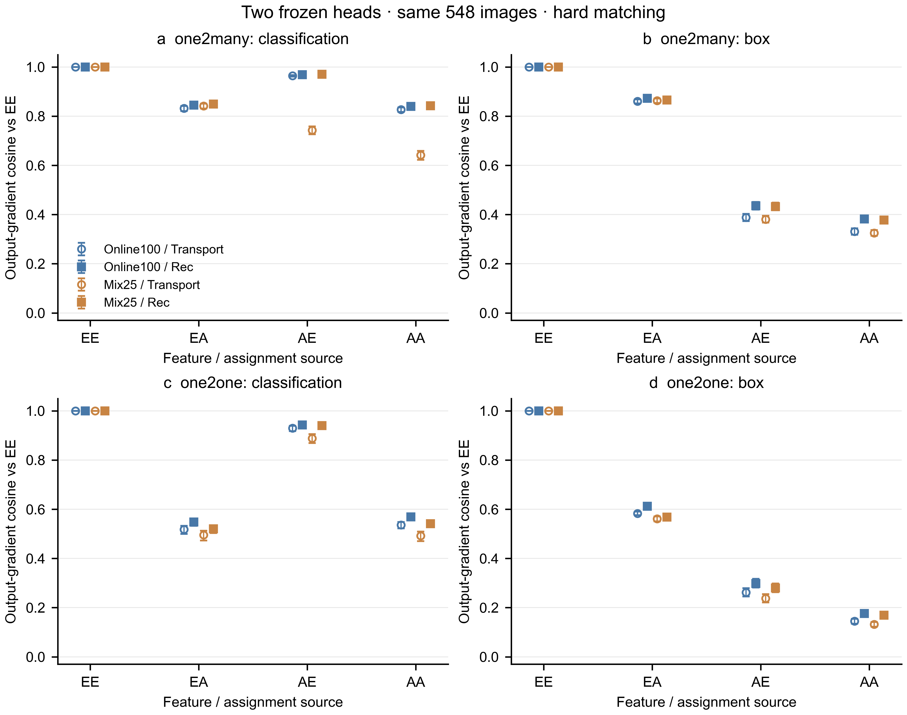
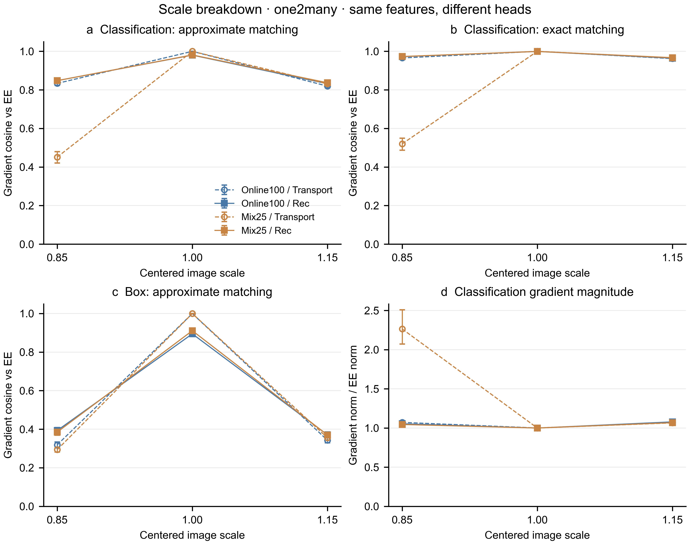

# Mix25 检测头复核：完成情况与下一步决策

日期：2026-10-18。主问题：此前的定位梯度恢复不足，是否仅出现在 Online100 检测头上？

## 完成与可比性

任务 `job-replication-mix25-20261016-mOtQ5Tzb` 已完成并自动归档，提交 `f2039af9669d2691ac7e6948c6478c61b37266fa`。
548 张既有 VisDrone 验证图全部完成，共 3,288 次真实特征查询、105,216 条干预记录，耗时 10,791.83 秒（约 3 小时）。
原生损失一致性最大绝对误差为 0，缓存一致性最大相对 L2 为 0.000136564；权重状态不变、训练更新为 0。

两轮图像顺序、六个变换、运行源码哈希、缓存、校正器状态与环境一致，仅冻结检测头不同。
所有逐行特征相对 MSE 完全相同；这也是符合设计的结果，因为没有更换特征或校正器。
因此不能把两轮相同的 MSE 改善当成两次独立验证。

这轮没有训练新检测器或产生新 AP。两个头来自同一骨干、同一数据集、各一个训练种子；并非跨模型或跨数据集测试。

## 复现了什么

下表为 hard_common 协议，先平均每张图的四个非恒等视角，再对 548 张图等权平均。
AA 为近似特征预测配近似特征分配，AE 为近似特征预测配真实特征分配。
数值是相对同图同视角 EE 的原始输出梯度余弦，越大表示方向越接近。

| 冻结头 / 近似 | one2many 分类 AA→AE | one2many 定位 AA→AE | one2one 定位 AA→AE |
|---|---:|---:|---:|
| Online100 / Transport | 0.826610→0.963931 | 0.330816→0.387938 | 0.144634→0.262064 |
| Mix25 / Transport | 0.641289→0.743165 | 0.324802→0.380187 | 0.131837→0.237685 |
| Online100 / Rec | 0.839975→0.968404 | 0.382021→0.435595 | 0.176281→0.298297 |
| Mix25 / Rec | 0.842393→0.970054 | 0.377584→0.432631 | 0.169242→0.280317 |

替换分配确实改善了梯度方向，但两种头的定位余弦仍较低；真实分配没有消除近似预测的定位偏差。
在 native_soft 下，Mix25 的 one2many 定位 AA 余弦是 Transport 0.137203、Rec 0.175428，和上一轮 0.139712、0.178602 接近。
可以保留“定位信号恢复仍不足”这一局部观察。不能据此宣布分配错误是 AP 下降的主要原因，也不能把梯度余弦当作 AP 恢复率。

## 新发现：缩小视角暴露出头相关的分类失配

以下聚焦 one2many、hard_common、0.85 倍缩小，两个翻转状态取均值：

| 冻结头 / 近似 | 分类 AA | 分类 AE | 分类梯度范数 / EE | 定位 AA |
|---|---:|---:|---:|---:|
| Online100 / Transport | 0.833684 | 0.965585 | 1.071839 | 0.318844 |
| Mix25 / Transport | 0.451275 | 0.520120 | 2.264354 | 0.293790 |
| Online100 / Rec | 0.847951 | 0.972401 | 1.054243 | 0.393066 |
| Mix25 / Rec | 0.847839 | 0.973144 | 1.045031 | 0.384942 |

同样的 Transport 特征，在 Mix25 头上的缩小视角产生更大的分类梯度，方向也更偏离真实特征参照。
即使换真实分配，分类余弦也只有 0.520120，因此“分配修正即可解决分类问题”不适用于所有条件。
Rec 在这里有明确的诊断收益；不能简单断言 Rec 完全无效。其定位收益和训练 AP 收益仍需要分别验证。

1.15 倍放大没有出现同等程度的分类异常，提示优先检查缩小引入的区域。
当前图像几何变换以 114/255 填充，特征传输使用 zero padding；原始 DINO 特征中的零不等于灰色填充图像的上下文特征。
这是具体的候选解释，尚未经区域干预证实。缩小也改变目标尺度、有效内容和边界，不能仅凭尺度曲线认定填充是原因。

## 研究判断与下一步

方法尚未定型。现有证据支持把重建、分类匹配和定位响应分开，但还没有建立一个超过 Random Mix 的新训练方法。
先完成[区域与等强度干预方案](../../NEXT_INTERVENTION_PLAN_20261018.md)，再决定是否值得训练新校正器：

1. 在固定训练开发图上区分新填充、原始 letterbox、有效前景和有效背景，测误差与梯度贡献；检查填充 oracle 和低成本填充基线。
2. 控制恢复位置数和残差范数，比较前景与背景的真实残差恢复，并加入相同位置/范数的随机方向控制。补测检测头参数梯度，避免只依据输出梯度作训练推断。
3. 只把有明确机制依据的一个候选送入全量 VisDrone 同预算训练；主要对照仍是 Mix25、Transport 及补强后的真实多视角缓存。
4. 候选在三个配对种子的最终 AP 与成本上取得可重复优势后，再做第二数据集、第二骨干和等总时间比较。

原有 Anchor/TaskAware 负结果保留，不能重新把“加前景权重”作为未经检验的新方案。
此轮没有启动新的 GPU 实验。

## 可用主张及边界

- **保留：** 在所测两个冻结头下，真实分配不足以恢复近似特征的定位输出梯度。证据为两协议、两分支的配对表；范围为当前骨干、种子与增强。下一步检验参数梯度和局部恢复。
- **收窄：** Rec 的收益依赖任务信号和条件。在 Mix25 的缩小视角有明显分类梯度改善。不能改写为检测精度已恢复，也不能将一个头的现象推广到所有训练方案。
- **待检验：** 填充区域主导缩小视角的分类异常。现有证据为尺度差异和实现规则；尚缺填充区域干预，不能作为论文已证实机制。
- **暂不支持：** 方法超过强混合基线、跨域泛化成立、获得新训练加速或已具备确定的 CVPR 方法创新。需要对应训练和近邻比较证据。

统计不确定性采用条件于现有 checkpoint 的图像与文件名前缀重采样，详见 `stats-appendix.md`。
