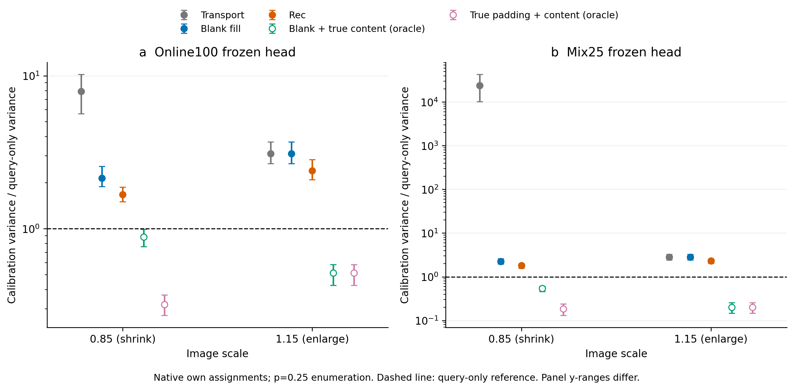
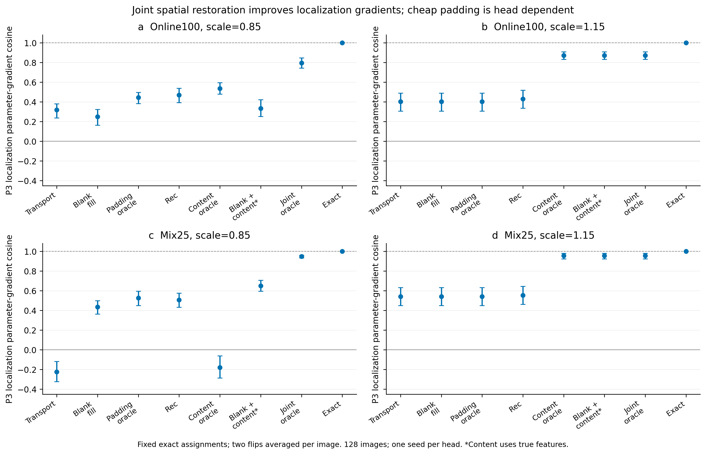

# 2026-10-19 联合干预与梯度校准分析

昨晚任务成功完成，但固定系数为 1 的三个部署候选全部未通过事先锁定的方差筛查。联合空间 oracle 提供了更清晰的机制证据；它尚未转化为可部署方法或 AP 收益。

## 结果与数据完整性

源任务：`runs/paper/joint-gradient/job-20261018-pJHRhd15/development`。结果提交 `b2f651af84269718ef556c869bda415973dd1383`，已重新用远端分支核对推送。128 张固定训练开发图，六个视角，两个 seed0、epoch100 冻结检测头。768 次真实图像特征提取加 1 次灰图提取。完整阶段用时 1216.979 秒（20.28 分钟），仅供此次诊断运行记录，不是训练成本比较。

状态哈希不变，零优化器更新。原生损失复现绝对差 0；缓存恒等视角最大相对 L2 为 9.0877e-5；校准条件期望最大相对误差 6.1811e-15。98,304 条原生梯度记录及完整输出/参数数据网格重新核验。此前六组的 18,432 条输出记录在分类余弦、定位余弦及原生损失上逐项差值均为 0。

原始数据只在服务器任务和本地 `raw/` 留存，不提交缓存、模型、图片或原始大表。校验及复现信息见 [verification.json](verification.json)。

## 1. 固定系数梯度校准未过门槛

公式 `ghat = ga + I/p * (ge-ga)`，p=0.25；以真实原生检测损失求梯度，每种特征使用自己的匹配。表中 R 是条件方差迹相对 query-only 估计 `I*ge/p` 的比值：`Σ||ge-ga||² / Σ||ge||²`。先累计图像与翻转视角的能量再取比值，不是逐图比值的平均。R<1 才表示该条件下的方差减少。

| 近似特征 | Online100 ×0.85 | Online100 ×1.15 | Mix25 ×0.85 | Mix25 ×1.15 |
|---|---:|---:|---:|---:|
| Transport | 7.8939 | 3.1018 | 23851.1418 | 2.8338 |
| Blank-fill | 2.1467 | 3.1017 | 2.2609 | 2.8338 |
| Rec | 1.6747 | 2.3944 | 1.8127 | 2.3082 |
| 灰图填充＋真实内容（oracle） | 0.8817 | 0.5142 | 0.5400 | 0.2015 |
| 真实填充＋真实内容（oracle） | 0.3193 | 0.5142 | 0.1846 | 0.2016 |

锁定条件要求一个部署候选在两个头、两个非恒等尺度的四组均 R<1。Transport、Blank-fill、Rec 的 12 个分组全部 R>1；eligible 为空，原筛查结论保持不变。两个 oracle 不是部署候选：它们利用了全量真实特征。

Mix25 ×0.85 Transport 的逐图 R 中位数为 3530.9398；128 张图全部 R>1。单张图贡献总残差能量的 36.51%，前五张贡献 68.76%，存在明显长尾；但仅作为敏感性检查，排除最大一张后总体 R 仍为 15680.18，排除前五张仍为 8889.01。不能归因于一个坏样本，也不能事后删除这些图使候选通过。

三个候选所有分组的逐点 95% 文件名前缀 bootstrap 敏感性区间下限仍大于 1，详见 [variance-screen.csv](variance-screen.csv)。这些区间仅反映当前样本与冻结头的重采样敏感性，不能解释为训练种子层面的显著性。

图的作用是区分数学条件均值正确与方差有用：校准虽然满足条件期望恒等式，固定系数的方差仍大。Oracle 低于阈值说明更准确的联合特征可能成为更好的控制量，不保证可学习性、成本优势或训练 AP。

## 2. 联合恢复比单独恢复更有信息，但廉价填充并不普适

以下是 one2many 分支 P3 共享层的定位参数梯度余弦，固定 exact 匹配并采用公共归一化。它与上一节原生损失是不同诊断，不能混用。定位包含 reg_max=1 的辅助 L1 项。每图先平均两个翻转视角，再对 128 图等权平均。

| 干预 | Online100 ×0.85 | Online100 ×1.15 | Mix25 ×0.85 | Mix25 ×1.15 |
|---|---:|---:|---:|---:|
| Transport | 0.318067 | 0.401647 | -0.224257 | 0.542088 |
| Blank-fill | 0.249291 | 0.401648 | 0.435897 | 0.542088 |
| 仅真实填充 | 0.444629 | 0.401647 | 0.525524 | 0.542088 |
| Rec | 0.469972 | 0.430546 | 0.505889 | 0.553150 |
| 仅真实内容 | 0.536095 | 0.871960 | -0.180066 | 0.954236 |
| 灰图填充＋真实内容 | 0.334624 | 0.871960 | 0.649757 | 0.954236 |
| 真实填充＋真实内容 | 0.794841 | 0.871960 | 0.947407 | 0.954236 |
| Exact | 1.000000 | 1.000000 | 1.000000 | 1.000000 |

Mix25 ×0.85：联合真实填充与内容达到 0.9474；相对 Transport 的配对差为 +1.1717（128/128 图为正）。灰图填充加真实内容达到 0.6498，仍比联合真实恢复低 0.2977（128/128 图）。这些是余弦差值，绝不是“恢复 95% AP”。

Online100 ×0.85：联合真实恢复达到 0.7948；但在真实内容已恢复时，用灰图填充会把余弦从 0.5361 降到 0.3346，配对差 −0.2015，97/128 图下降。说明无上下文灰图模板不能替代真实填充响应。灰图修复还作用于部分混合边界，因此两种联合干预的差异不能唯一归因于纯填充区。

放大至 ×1.15 时，恢复有效内容后两个头分别达到 0.8720、0.9542；此时新增纯填充不再是主要区别。应按缩放方向和检测头分别讨论，避免全视角平均掩盖差异。

这个图支持继续研究填充/内容联合失配及头的敏感性。自然区域的 token 数、残差能量和语义内容同时改变，尚不构成“前景决定定位”或独立因果分解的证据。

## 3. 为什么不直接继续调一个校准强度

这是看到失败后的探索性计算，不改变原门槛。利用已有梯度能量和内积，求每个头/尺度在同一数据上拟合的理想单标量 α，使 `α ga + I/p*(ge-α ga)` 方差最小。α取 `Σ<ge,ga>/Σ||ga||²`；同集最小方差比为 `1 - (Σ<ge,ga>)²/(Σ||ga||² Σ||ge||²)`。

| 检测头 | scale | 同集最优单标量 α | 理想方差比 |
|---|---:|---:|---:|
| mix25 | 0.85 | 0.210749 | 0.937603 |
| mix25 | 1.15 | 0.175750 | 0.937693 |
| online-geom | 0.85 | 0.216462 | 0.944250 |
| online-geom | 1.15 | 0.166011 | 0.942468 |

Rec 的这个同集、单标量理想诊断也只显示约 5.6%–6.2% 方差减少，尚未扣除额外检测头前后向成本。它不支持立即投入一次大规模 α 扫描，更不能当作独立验证或新方法结果。这个上界只针对该组共享一个标量的拟合；不排除更丰富、严格独立校准的控制量。

## 下一步决策

1. 保留这次负结果，停止推进当前固定系数梯度校准至全量训练，不修改门槛解释成通过。
2. 先补齐真正有竞争力的简单基线：全量同协议下的 Blank-fill + Transport25，以及少量真实离散缩放缓存。使用官方评估口径、最终 epoch AP 和完整缓存/查询/训练成本；现有固定头 oracle 不能替代这些训练结果。
3. 机制实验沿原计划做等 token 数、等残差范数的内容区域干预，并把真实填充与廉价填充分开。目标是识别有限计算应花在哪里；单纯再加一个前景加权损失缺乏当前证据，历史负结果也须保留。
4. 有候选在同预算下稳定超过 Transport25、补强填充和多视角缓存后，再进入完整数据三种子、第二数据集/骨干及等时间预算。当前仍处于方法探索，没有方法定型或 CVPR 竞争力结论。

本轮没有启动新的 GPU 训练；没有候选通过预设下一阶段筛查。上述基线与受控干预为后续建议，尚未运行。

## 可用与不可用的表述

- 保留：在本次固定头诊断中，联合真实填充与内容恢复改善定位参数梯度。证据为 spatial-cells/paired-contrasts；不确定性为单训练种子、自然区域强度不匹配。下一步检查等强度干预和训练 AP。
- 保留负结论：该固定系数原生梯度校准没有通过预设方差筛查。证据为完整逐图数据、variance-screen 与原 screening.json。不能扩展为所有控制变量方法无效。
- 弱化：缓存增强的失配具有空间结构且依赖检测头。不能写成“发现全新机制”或“证明填充是唯一瓶颈”。
- 禁止：把 oracle 的余弦 0.95 当作 AP 恢复 95%，把枚举 p=0.25 当作实际仅查询 25%，把两个不同训练策略的头当作两个独立训练种子，或用这128图诊断与 YOLO-Master 官方 AP 对比。
